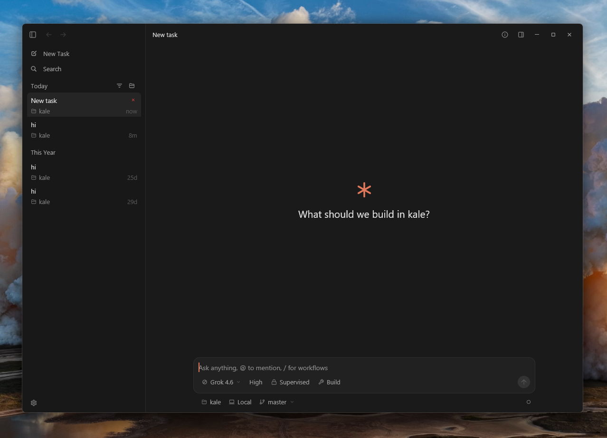

# Hiroshi

A GPU-native desktop cockpit for multi-agent development, built with React and
GPUIX. The desktop interface renders directly through GPUI, without Electron or
a web view.



## Current state

Hiroshi is in active development. The local engine runs independently of the
window and persists its work in SQLite. It supports:

- Shell commands with streamed output, exit status and cancellation.
- Durable session inboxes with steering, queued prompts and interrupts.
- Streaming steps with bounded retries and explicit crash recovery.
- Context budgeting and compaction that preserve the full transcript.
- Model-requested tools with cockpit approvals, policy and durable results.
- Pre-prompt checkpoints that rewind workspace files and conversation together.
- One typed HTTP protocol and a replayable event feed for multiple clients.

The Terminal surface connects to the engine and shows runs, steps, pending
prompts and context history. The main composer streams answers from the selected
engine model. OpenAI Responses and Anthropic Messages adapters use local
configuration and credentials; the built-in local echo needs neither. The full
multi-agent workflow is still being built, and parts of the cockpit remain
demonstrations. See [provider configuration](docs/providers.mdx) and
[tools and permissions](docs/tools.mdx), and [checkpoints](docs/checkpoints.mdx).

Follow progress in [The cockpit that ships](https://github.com/hiroshi-os/Hiroshi/milestone/1).
See [the engine documentation](docs/engine.mdx) for its architecture and guarantees.

## Run locally

Install Git for workspace checkpoints. Use the Bun version pinned in [`.bun-version`](.bun-version). From the repository
root:

```sh
bun install --frozen-lockfile
bun run dev
```

The desktop app starts or attaches to the local engine. Closing the window leaves
its shell commands running; another window can attach to the same engine.

To run or inspect the engine directly:

```sh
bun run engine
bun run engine:status
```

## Development

| Command | Purpose |
| :--- | :--- |
| `bun run typecheck` | Check TypeScript |
| `bun run test:engine` | Test the engine with SQLite and real daemon processes |
| `bun run test` | Test the UI through the native GPUIX test renderer |
| `bun run test:integration` | Drive a real desktop window and its engine |
| `bun run screenshot` | Capture desktop UI screenshots |
| `bun run build` | Compile the desktop app into `dist/hiroshi` |
| `bun run web:dev` | Bundle and serve the browser preview |

The engine suite needs no GPU. Native UI tests run on macOS and Windows;
windowed integration tests and screenshots need a desktop session. The browser
preview does not start the local daemon.

## Local data

| Platform | Default directory |
| :--- | :--- |
| Windows | `%LOCALAPPDATA%\Hiroshi` |
| macOS | `~/Library/Application Support/Hiroshi` |
| Linux | `$XDG_STATE_HOME/hiroshi`, or `~/.local/state/hiroshi` |

Set `HIROSHI_HOME` to use another directory. It contains `engine.db`, the discovery
file `engine.json`, the startup lock `engine.lock` and `logs/engine.log`.

## Documentation and releases

The [documentation source](docs/) is a Mintlify project. To preview it with the
Mintlify CLI installed:

```sh
cd docs
mint dev
```

Hiroshi uses `0.MINOR.PATCH` releases while the shell and application surface
stabilize. The current version is in [`package.json`](package.json); release
notes are in [the changelog](CHANGELOG.md).
